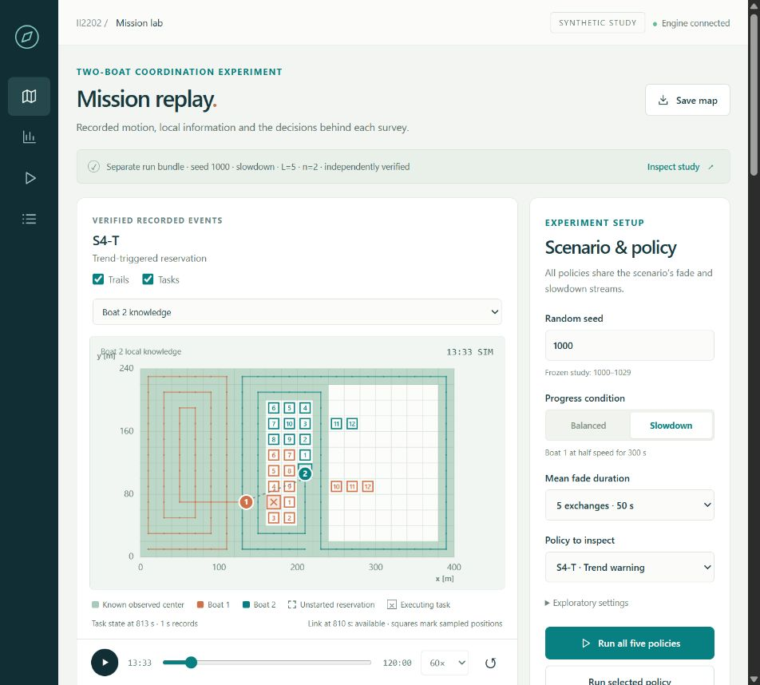

# RMSW Project · II2202

Andrea Lo Iacono and Ettore Mugisha Cirillo. Controlled two-USV coverage under intermittent radio communication.

The **USV Research Lab** provides an animated simulator, synchronized policy comparisons, statistical charts, raw-event inspection, experiment controls, automated verification and a five-scene interactive presentation. From the repository root on Windows:

```powershell
.\Run-Lab.ps1 -Setup       # first run: install into a local environment
.\Run-Lab.ps1              # later runs: open the dashboard
.\Run-Lab.ps1 -Action Smoke
.\Run-Lab.ps1 -Action Full -Workers 4
```

Open `http://127.0.0.1:8768`. New runs are saved as separate, reproducible evidence bundles. See the [dashboard guide](code/docs/dashboard-guide.md). Other tools should start with [AGENTS.md](AGENTS.md) and the [agent handoff](code/docs/agent-handoff.md); completed work is recorded in the [work log](code/docs/work-log.md).

Start with the [first-run walkthrough](code/docs/first-run-walkthrough.md) for a worked example, the five methods, decision inspection, results, tests and presentation controls.



The revised research plan is implemented. The core evaluation contains 900 runs, five configurations, six conditions, and 30 paired evaluation seeds per condition, following a separate 300-run pilot. All 900 evaluation logs passed metric reconstruction. Results are synthetic evidence; the report remains a working draft for both authors to review.

```text
paper/
  Final_Report/              Active modular final report; main.tex
  research-plan/             Unmodified live Overleaf snapshot, 23 Oct 2026
  professor-template-2026/   Unmodified assigned report template
  Proposal/                 Preserved earlier proposal
code/
  simulation/               Simulator, tests, frozen design, analysis, replay
  docs/                     Provenance and implementation decisions
  data/                     Data notes
```

- [Final-report Overleaf project](https://www.overleaf.com/project/6adaa2ee04fc36dc7bdb36ac)
- [Research-plan Overleaf project](https://www.overleaf.com/project/6abd035913fae5baa946157b)
- [Simulator and reproduction commands](code/simulation/README.md)
- [Results and review limits](code/docs/results-and-review.md)
- [Plan-to-code mapping](code/docs/plan-to-code.md)
- [Sources and preservation](code/docs/provenance.md)
- [Dashboard architecture and API](code/docs/architecture.md)

Fixed partitioning completed every evaluation run. Reactive short queues completed none: this no-rendezvous model permits boats to exhaust work beyond radio range. Long queues and predictive variants completed most runs. Trend prediction showed no consistent benefit over an always-long queue or persistence. Do not treat the contrast with the stalled reactive policy as proof of forecast skill or convert operation/byte counts into measured energy savings.

Compile inside `paper/Final_Report/` with LuaLaTeX and BibTeX, using `main.tex`. `II2202-report.tex` is a compatibility wrapper for the original template setting. The assigned font, 11-point body, margins, spacing, and headings are retained; a stray `w` in its section-format command is corrected. GitHub icons and a boxed repository link follow the plan styling. The course forbids the KTH logo on this report.

Regenerate the six supplementary evidence tables with `python code/simulation/scripts/build_report.py`. This checks the frozen matrix and records source/output hashes without overwriting report prose. Create an Overleaf source package with `python code/simulation/scripts/package_report.py --output <new.zip>`. Back up and compare the live project before uploading; compile and inspect its PDF afterward. The [draft notes](paper/Final_Report/DRAFT-NOTES.md) map the report to the reviewed plan and distinguish evidence from pending author review.

The original proposal is preserved byte-for-byte at its new location. The existing dirty local clone was untouched. GitHub and Overleaf synchronization is manual; the final-report project contains paper sources and figures only. Coordinate edits, upload the paper package, recompile, and verify the PDF.

Course requirements checked on 23 October 2026: [first draft/template](https://canvas.kth.se/courses/63857/assignments/393674), [formatting](https://canvas.kth.se/courses/63857/pages/templates-and-formatting), [final report](https://canvas.kth.se/courses/63857/assignments/393673). Main body: at most ten pages excluding cover, references, appendices. No course submission has been made.
