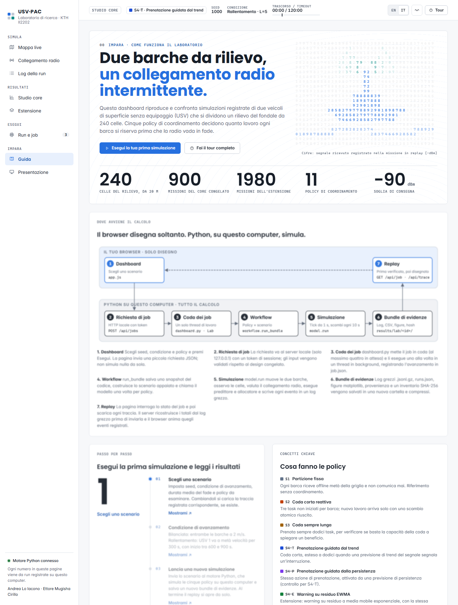

# RMSW Project · II2202

Andrea Lo Iacono and Ettore Mugisha Cirillo. Controlled two-USV coverage under intermittent radio communication.

## Branch workflow

The report and simulator share this repository so that each report version can be matched to the code that produced its results.

| Branch | Purpose | Merge into |
| --- | --- | --- |
| `dev-paper` | Write and revise the LaTeX report in `paper/`, including references, tables and figures. | `dev` |
| `dev-code` | Develop the simulator, tests and analysis scripts in `code/`. | `dev` |
| `dev` | Integrate paper and code changes. Check that the report compiles and its figures and tables match the experiment outputs. | `main` when the final version is ready |
| `main` | Hold the agreed final version of the report and its corresponding code. | — |

Both working branches start from `dev`. At the start of each round of edits, bring the latest `dev` changes into your working branch. When opening a pull request from `dev-paper` or `dev-code`, select **`dev` as the base branch**. If a script change affects a figure, merge the script change into `dev` first, sync `dev-paper` with `dev`, then update the figure and its discussion together.

## Project guide

For the split webapp and engine, open **Manage-Lab.cmd** on Windows. Choose **3** to start both with Docker Desktop or **4** to start them with native Python. **7** and **8** stop the corresponding pair. The [deployment guide](docs/deployment.md) also covers engine-only modes and an HTTPS webapp connected to an engine on a separate PC.

| Where | What to open |
| --- | --- |
| code/simulator/usv_sim/ | Start at model.py for boats, radio and task allocation. The engine runs on the operator's PC. |
| code/webapp/ | relay.py serves the dashboard. static/index.html, app.js and style.css define the interface. |
| code/simulator/results/ | core/ holds the original 900-mission study, extension/ the follow-up and lab/ new jobs. |
| code/simulator/tests/ | Tests of the model, scientific outputs and local dashboard API. |
| code/webapp/tests/check_stack.py | Integration check for a running engine and web service. |
| code/simulator/scripts/ | Generate paper figures, tables and a submission ZIP. Run-Study.ps1 also supports native scientific workflows. |
| docs/ | Operating guides, design decisions and validation records. |

The GitHub workflow runs on pushes to main, dev and branches starting with dev-code. Pull requests use the same target branches. Jobs are skipped for pull requests from dev-paper. The scientific check runs unit tests and five reference missions. The Windows integration check starts both services natively on a GitHub runner. Ubuntu builds both Docker images and exercises the API and the browser. These jobs stop their services after testing.

Open `http://127.0.0.1:8768`. New runs are saved as separate, reproducible evidence bundles. See the [dashboard guide](docs/dashboard-guide.md). Other tools should start with [AGENTS.md](AGENTS.md) and the [agent handoff](docs/agent-handoff.md); completed work is recorded in the [work log](docs/work-log.md).

Open the dashboard's **Guide** for a step-by-step first simulation and a tour of every control (English/Italian). The [documentation index](docs/README.md) lists everything else, starting from the [27 October summary PDF](docs/aggiornamento-per-ettore-2026-10-27.pdf).



The revised research plan is implemented. The core evaluation contains 900 runs, five configurations, six conditions, and 30 paired evaluation seeds per condition, following a separate 300-run pilot. All 900 evaluation logs passed metric reconstruction. Results are synthetic evidence; the report remains a working draft for both authors to review.

```text
paper/
  Final_Report/              Active modular final report; main.tex
  research-plan/             Unmodified live Overleaf snapshot, 23 Oct 2026
  professor-template-2026/   Unmodified assigned report template
  Proposal/                 Preserved earlier proposal
code/
  simulator/                Simulation engine, research results and tests
  webapp/                   Web gateway, browser interface and integration check
docs/                       Guides and validation records
```

- [Final-report Overleaf project](https://www.overleaf.com/project/6adaa2ee04fc36dc7bdb36ac)
- [Research-plan Overleaf project](https://www.overleaf.com/project/6abd035913fae5baa946157b)
- [Simulator and reproduction commands](code/simulator/README.md)
- [Results and review limits](docs/results-and-review.md)
- [Plan-to-code mapping](docs/plan-to-code.md)
- [Sources and preservation](docs/provenance.md)
- [Dashboard architecture and API](docs/architecture.md)

Fixed partitioning completed every evaluation run. Reactive short queues completed none: this no-rendezvous model permits boats to exhaust work beyond radio range. Long queues and predictive variants completed most runs. Trend prediction showed no consistent benefit over an always-long queue or persistence. Do not treat the contrast with the stalled reactive policy as proof of forecast skill or convert operation/byte counts into measured energy savings.

Compile inside `paper/Final_Report/` with LuaLaTeX and BibTeX, using `main.tex`. `II2202-report.tex` is a compatibility wrapper for the original template setting. The assigned font, 11-point body, margins, spacing, and headings are retained; a stray `w` in its section-format command is corrected. GitHub icons and a boxed repository link follow the plan styling. The course forbids the KTH logo on this report.

Regenerate the six supplementary evidence tables with `python code/simulator/scripts/build_report.py`. This checks the frozen matrix and records source/output hashes without overwriting report prose. Create an Overleaf source package with `python code/simulator/scripts/package_report.py --output <new.zip>`. Back up and compare the live project before uploading; compile and inspect its PDF afterward. The [draft notes](paper/Final_Report/DRAFT-NOTES.md) map the report to the reviewed plan and distinguish evidence from pending author review.

The original proposal is preserved byte-for-byte at its new location. The existing dirty local clone was untouched. GitHub and Overleaf synchronization is manual; the final-report project contains paper sources and figures only. Coordinate edits, upload the paper package, recompile, and verify the PDF.

Course requirements checked on 23 October 2026: [first draft/template](https://canvas.kth.se/courses/63857/assignments/393674), [formatting](https://canvas.kth.se/courses/63857/pages/templates-and-formatting), [final report](https://canvas.kth.se/courses/63857/assignments/393673). Main body: at most ten pages excluding cover, references, appendices. No course submission has been made.
